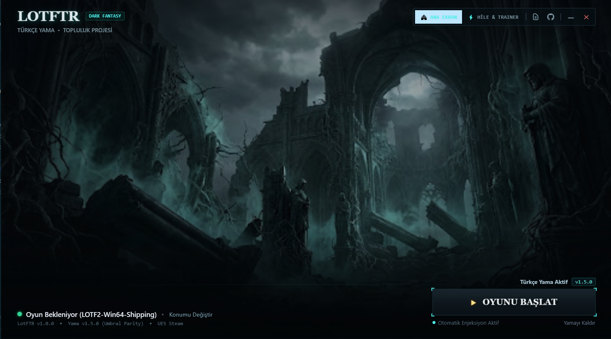
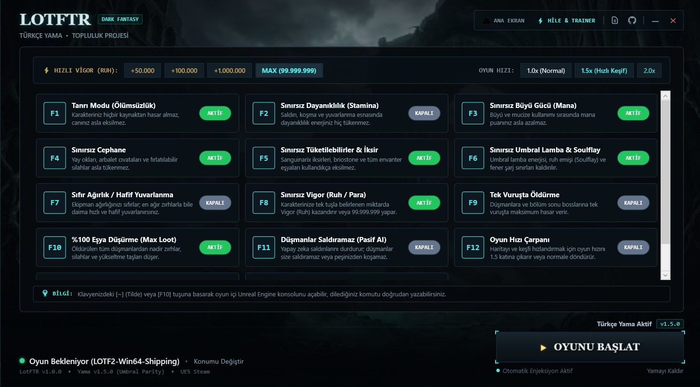
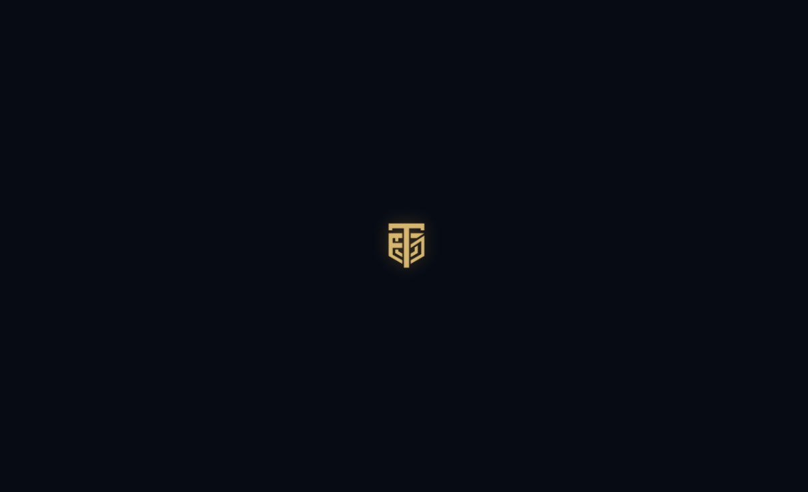

# Lords of the Fallen - Türkçe Yama ve Trainer (LotfPanel)

Lords of the Fallen (2023 / v2.5.624F) için hazırladığım %100 Türkçe yama ve 13 fonksiyonlu trainer kontrol paneli.

Bu uygulama oyunun orijinal dosyalarını bozmaz, kurulum gerektirmez ve doğrudan taşınabilir (portable) olarak çalışır.

---

## Ekran Görüntüleri

### Başlatıcı & Ana Kontrol Paneli

### Trainer & Hile Menüsü

### Giriş Ekranı

---

## Özellikler

### Türkçe Yama
- Oyunun ana menüsü, ayarları, sinematik ara sahneleri, tüm NPC konuşmaları ve hikaye diyalogları %100 Türkçedir.
- Silahlar, zırhlar, büyüler, yüzükler ve gizli hikaye (lore) açıklamaları eksiksiz çevrilmiştir.
- Umbral lamba kalıntı hatıraları (Stigma sesleri ve altyazıları) dahildir.
- Oyun dosyalarınıza zarar vermez; dilediğiniz an paneli kapatabilir veya yamayı kaldırabilirsiniz.

### Trainer / Hile Özellikleri (13 Fonksiyon)
Hileleri panel üzerinden butonlara tıklayarak veya oyun içerisindeyken klavye kısayollarıyla açıp kapatabilirsiniz:

- **F1 - Tanrı Modu:** Ölümsüzlük. Canınız asla azalmaz ve hasar almazsınız.
- **F2 - Sınırsız Dayanıklılık (Stamina):** Koşma, yuvarlanma ve saldırılar yeşil dayanıklılık barını tüketmez.
- **F3 - Sınırsız Büyü Gücü (Mana):** Büyü ve mucize kullanımı mana harcamaz.
- **F4 - Sınırsız Cephane:** Ok, cıvata ve fırlatılabilir silahlar tükenmez.
- **F5 - Sınırsız İksir ve Eşyalar:** Sanguinarix iksirleriniz ve tüketilebilir eşyalarınız bitmez.
- **F6 - Sonsuz Umbral Lamba:** Fener enerjisi ve ruh çekme (Soulflay) sınırsızdır.
- **F7 - Sıfır Ağırlık:** En ağır zırhları giyseniz dahi daima en hafif yuvarlanmayı (light roll) yaparsınız.
- **F8 - +100.000 Vigor Ekle:** Her basışta envanterinize anında 100.000 Vigor ekler.
- **F9 - Tek Vuruşta Öldürme:** Düşmanlara maksimum darbe vurarak tek hamlede etkisiz hale getirir.
- **F10 - %100 Eşya Düşürme:** Öldürülen her düşmandan maksimum eşya/loot düşer.
- **F11 - Düşmanları Dondur:** Düşmanlar donar, peşinize takılmaz ve size saldıramaz.
- **F12 - Oyun Hızı Çarpanı:** Haritayı hızlı keşfetmek için oyun hızını 1.5x / 2.0x / 3.0x katına çıkarır.
- **NUM 1 - Seçili Eşyayı 999 Yap:** Kemerinizde o an seçili olan eşyanın miktarını anında 999 adet yapar.
- **[~] veya F10 - Konsol:** Oyun içi Unreal Engine konsolunu açar.

---

## İndirme ve Kurulum

1. Sağ tarafta yer alan **[Releases](https://github.com/furkantecir/lords-of-fallen/releases)** bölümünden son sürüm ZIP paketini (`LotfPanel_v1.0_Kurulum_Paketi.zip`) indirin.
2. İndirdiğiniz ZIP dosyasını bilgisayarınızda istediğiniz bir klasöre çıkartın.
3. `LotfPanel.exe` dosyasını çalıştırın.
4. Panel, oyununuzun kurulu olduğu klasörü otomatik olarak bulacaktır.
5. Sağ alttaki **Oyunu Başlat** butonuna tıklayarak Türkçe ve hileler aktif şekilde oyuna girebilirsiniz.

*Not: Yama ve trainer çevrimdışı (offline) hikaye modu için geliştirilmiştir. Çevrimdışı modda EAC korumasını güvenle atlatır.*

---

## Geliştirici

**Furkan Tecir (FuTe)**  
GitHub: [@furkantecir](https://github.com/furkantecir)
